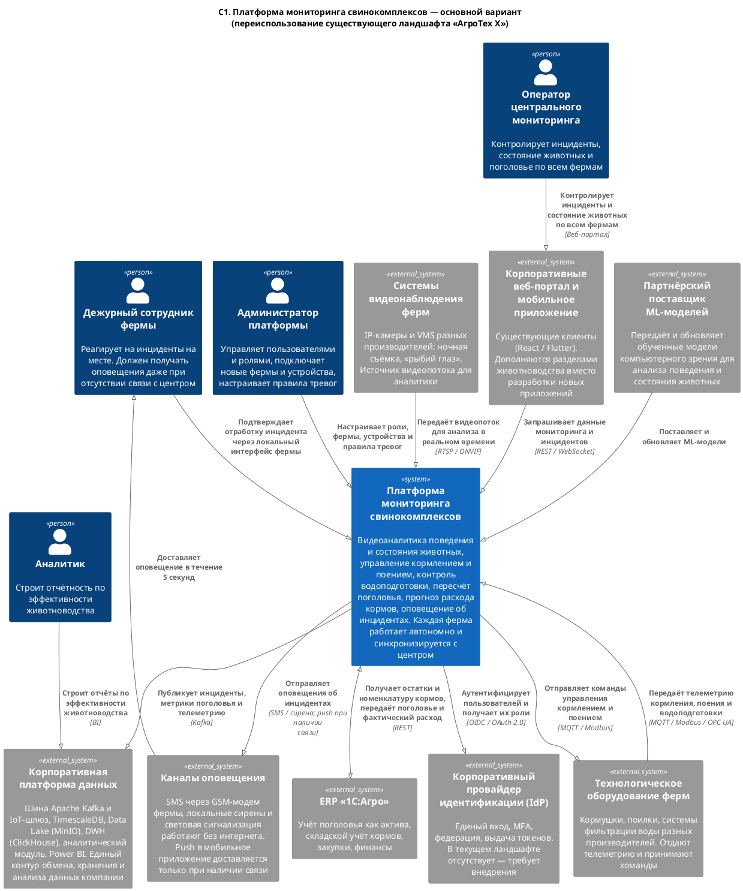
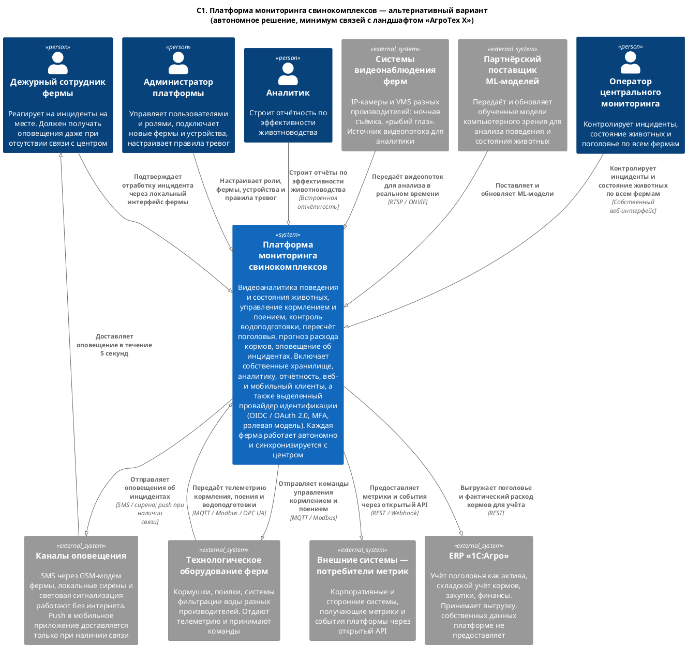

### **Название задачи:** Выбор архитектуры MVP платформы мониторинга свинокомплексов «АгроТех Х»

### **Автор:** Андрей Смолин

### **Дата:** 11.10.2026

---

### **Функциональные требования**

Верхнеуровневые Use Cases.

| **№** | **Действующие лица или системы** | **Use Case** | **Описание** |
| :-: | :- | :- | :- |
| 1 | Системы видеонаблюдения, платформа, дежурный сотрудник, оператор | Фиксация нештатной ситуации средствами видеоаналитики | Фиксируемые типы событий: беспокойное поведение, драка, задавливание поросят, признаки болезни, гибель животного.  **Основной поток** (высокий приоритет: беспокойное поведение, драка, задавливание поросят): 1. Камера передаёт видеопоток на edge-устройство фермы. 2. ML-модель фиксирует признаки события в секции. 3. Платформа формирует инцидент с привязкой к ферме, секции, времени и видеофрагментом-подтверждением. 4. Дежурный сотрудник получает оповещение не позднее 5 секунд с момента события. 5. Дежурный подтверждает получение и отрабатывает инцидент на месте, фиксируя результат в локальном интерфейсе. 6. Оператор центрального мониторинга получает инцидент после синхронизации, не позднее 10 минут. Экстренное реагирование обеспечивается дежурным на месте, так как канал до центра не гарантирован.  **Альтернативный поток** (низкий приоритет: признаки болезни, гибель животного): 4а. Инцидент помещается в рабочую сводку фермы без экстренного оповещения. 5а. Дежурный отрабатывает его в плановом порядке. |
| 2 | Технологическое оборудование ферм, платформа, дежурный сотрудник, оператор | Фиксация отклонения по телеметрии оборудования | 1. Шлюз оборудования фермы принимает телеметрию кормушек, поилок и систем фильтрации воды через адаптер протокола конкретного производителя. 2. Платформа сопоставляет значения с пороговыми правилами: расход и давление воды, показатели фильтрации, остаток корма в бункере, статус и доступность устройства. 3. При выходе за пороги или при пропадании сигнала от устройства формируется инцидент. 4. Дежурный сотрудник получает оповещение. 5. Дежурный устраняет неисправность на месте и закрывает инцидент либо эскалирует его оператору. 6. Инцидент и его статус синхронизируются с центром. |
| 3 | Системы видеонаблюдения, платформа, оператор, ERP «1С:Агро» | Пересчёт поголовья | 1. Пересчёт запускается по регламентному расписанию, а также по запросу оператора. 2. ML-модель подсчитывает животных по секциям фермы. 3. Платформа сохраняет результат пересчёта и сверяет его с учётным значением. 4. При расхождении сверх допустимого порога формируется инцидент. 5. Оператор разбирает расхождение и подтверждает либо отклоняет новое значение. 6. Только после подтверждения оператором скорректированное поголовье передаётся в ERP «1С:Агро».  Автоматическая запись в ERP без подтверждения не допускается: поголовье является активом на балансе, а точность распознавания ограничена. |
| 4 | Оператор, платформа, технологическое оборудование ферм, дежурный сотрудник | Управление кормлением и поением | 1. Оператор настраивает расписание кормления и поения для фермы и секции. 2. Расписание доставляется на агент фермы вместе с конфигурацией. 3. В назначенное время платформа отдаёт команду оборудованию через адаптер протокола конкретного производителя. 4. Оборудование подтверждает выполнение, платформа фиксирует факт кормления и фактический расход корма. 5. Фактический расход передаётся в контур учёта запасов (UC 5). 6. При отказе оборудования или отсутствии подтверждения формируется инцидент по сценарию UC 2, дежурный устраняет неисправность на месте. |
| 5 | Платформа, ERP «1С:Агро», оператор | Контроль запасов кормов и прогноз расхода | 1. Платформа получает из ERP «1С:Агро» остатки и номенклатуру кормов. 2. Платформа получает фактический расход корма от оборудования ферм (UC 4). 3. На основании истории расхода, поголовья и норм кормления рассчитывается прогноз расхода и дата исчерпания запаса. 4. При достижении порогового запаса оператор получает предупреждение с указанием прогнозного срока. 5. Оператор инициирует закупку во внешнем процессе. 6. Фактический расход передаётся в ERP для сведения складского учёта. |
| 6 | Платформа, дежурный сотрудник | Работа фермы при отсутствии связи с центром | 1. Канал связи с центром недоступен. 2. Агент фермы продолжает видеоаналитику, приём телеметрии и управление оборудованием локально. 3. Инциденты фиксируются в локальном хранилище, оповещения доставляются дежурному по локальным каналам: сирена, световая сигнализация, SMS через GSM. 4. Дежурный подтверждает и закрывает инциденты в локальном интерфейсе, не требующем связи с центром. 5. После восстановления связи накопленные события, статусы и метрики передаются в центр. 6. Центр разрешает конфликты по правилу «источником истины по инциденту является ферма» и обновляет сводную картину. |
| 7 | Администратор платформы | Подключение новой фермы и оборудования | 1. Администратор заводит ферму и её секции в реестре объектов. 2. Регистрирует агента фермы и выдаёт ему сервисные учётные данные. 3. Добавляет камеры и технологическое оборудование, указывая производителя и протокол подключения. 4. Платформа подбирает соответствующий адаптер протокола и проверяет доступность устройств. 5. Платформа начинает приём видеопотока и телеметрии, агент получает конфигурацию и актуальную версию ML-модели. 6. Администратор назначает сотрудникам роли в разрезе данной фермы. |
| 8 | Администратор платформы, провайдер идентификации | Управление пользователями и ролями | 1. Администратор создаёт учётную запись сотрудника. 2. Учётная запись заводится в провайдере идентификации, сотруднику назначается способ входа: единый вход и многофакторная аутентификация. 3. Администратор назначает роль с привязкой к ферме или к группе ферм: дежурный, оператор, аналитик, администратор. 4. Платформа разграничивает доступ к данным и операциям в соответствии с ролью и областью её действия. 5. При увольнении или смене должности администратор отзывает права, доступ прекращается во всех интерфейсах платформы. 6. Все изменения прав фиксируются в журнале аудита. |
| 9 | Администратор платформы, платформа, внешние системы-потребители | Передача метрик во внешние системы и добавление собственных метрик | **Основной поток — базовые метрики:** 1. Платформа непрерывно рассчитывает базовый набор метрик: количество и типы инцидентов, поголовье, расход кормов, доступность оборудования, показатели водоподготовки. 2. Метрики публикуются во внешние системы по согласованному контракту. 3. Внешняя система-потребитель забирает метрики и использует их в собственной отчётности.  **Альтернативный поток — пользовательские метрики:** 1а. Администратор определяет собственную метрику: источник данных, формулу агрегации, период расчёта и разрез. 2а. Платформа начинает рассчитывать и публиковать её наравне с базовыми, без доработки кода. 3а. Новая метрика становится доступна потребителям через тот же контракт. |

---

### **Нефункциональные требования**

Нефункциональные и архитектурно значимые требования.

| **№** | **Требование** |
| :-: | :- |
| 1 | **Доступность.** Отказоустойчивость системы не ниже 99,95%. Отсутствие связи фермы с центром не считается отказом: ферма обязана функционировать автономно. |
| 2 | **Производительность, оповещение.** От момента возникновения нештатной ситуации, зафиксированной видеоаналитикой, до оповещения — не более 5 секунд. |
| 3 | **Производительность, видеоаналитика.** Обработка видеопотока и детектирование событий в реальном времени, в пределах миллисекунд. |
| 4 | **Автономность.** Полнофункциональная работа фермы при отсутствии интернета, включая локальное оповещение дежурного сотрудника. |
| 5 | **Согласованность.** Допустимая задержка синхронизации между агентом фермы и центральной системой — до 10 минут, не считая времени недоступности канала связи. |
| 6 | **Масштабируемость.** Отсутствие архитектурного ограничения на количество агентов (ферм). Горизонтальное масштабирование центральной системы. |
| 7 | **Расширяемость.** Добавление нового функционала без изменения существующего. Поддержка пользовательских метрик помимо базового набора. |
| 8 | **Интероперабельность.** Поддержка видеокамер, кормушек, поилок и систем водоподготовки разных производителей. |
| 9 | **Безопасность.** Разделение ролей, современные механизмы аутентификации и авторизации (OIDC / OAuth 2.0, MFA). |
| 10 | **Интеграционный контракт.** Наличие API, достаточного для разработки мобильного и веб-приложения, и для передачи метрик во внешние системы. |
| 11 | **Ограничение по инфраструктуре.** На каждой ферме допустим один сервер и необходимый набор edge-устройств. |
| 12 | **Ограничение по связи.** Нестабильный WiFi на фермах. Необходимы альтернативные каналы связи (GSM/LTE, проводные, LoRaWAN для телеметрии). |
| 13 | **Ограничение по оборудованию.** Камеры должны обеспечивать съёмку в ночное время. Допускается применение объективов «рыбий глаз» с потерей качества по краям кадра. |
| 14 | **Внешняя зависимость.** Обученная ML-модель компьютерного зрения поставляется партнёром. |

---

### **Решение**

Основной вариант — **интеграционный**: платформа мониторинга встраивается в существующий ландшафт «АгроТех Х» и максимально переиспользует его компоненты.

Исходник: [`C1_Context_Main.puml`](./C1_Context_Main.puml)

#### Логика принятия решения

**Топологию «центр — автономные агенты» определяют сами требования.**
Требования 2, 3 и 4 рассматриваются вместе и не оставляют альтернативы: инференс ML-модели должен выполняться на ферме, на edge-устройствах. Передавать сырой видеопоток в центр не позволяет пропускная способность канала. Одна камера 1080p в кодеке H.264 даёт 2–4 Мбит/с. Покрытие свинарника без слепых зон требует десятков камер, то есть от 100 до 250 Мбит/с непрерывного потока с одной площадки, при том что условие прямо фиксирует нестабильный WiFi. Даже при идеальном канале круговая задержка до центра исключает реакцию «в пределах миллисекунд». Отсюда: видео не покидает ферму, в центр уходит только событие и короткий фрагмент-подтверждение.

**Контуры разделены по времени реакции.**
Оперативный контур — детектирование, формирование инцидента, оповещение дежурного — целиком локален и укладывается в 5 секунд без единого обращения к центру. Контур синхронизации с центром обслуживает сводную картину, аналитику и отчётность; для него требование 5 допускает задержку до 10 минут, что позволяет строить его асинхронно, с буферизацией и повторной доставкой. Такое разделение одновременно закрывает требования 1, 2, 4 и 5.

**Корпоративная платформа данных переиспользуется.**
Apache Kafka уже является шиной компании, через неё проходят данные теплиц, полей и парка техники. DWH на ClickHouse и Power BI уже обслуживают аналитиков. Строить для MVP второй аналитический контур означало бы дублировать работающую инфраструктуру, увеличить сроки и получить два источника истины по отчётности. Платформа публикует инциденты, метрики и телеметрию в существующую шину, дальше данные идут штатным маршрутом в хранилище.

**Клиентские приложения переиспользуются.**
Веб-портал на React и мобильное приложение на Flutter уже внедрены и знакомы сотрудникам. Для требования 10 в существующие клиенты добавляются разделы животноводства, новые приложения не разрабатываются. Исключение сделано для локального интерфейса дежурного: он обязан работать без связи с центром, поэтому входит в состав агента фермы.

**Интеграция с ERP «1С:Агро» двусторонняя.**
Складской учёт кормов остаётся в ERP как в системе-источнике истины. Платформа получает остатки и номенклатуру, возвращает фактический расход и подтверждённое поголовье. Граница проведена так, чтобы не дублировать складской учёт и не создавать второй реестр активов.

**Аутентификация вынесена в корпоративный IdP.**
Требование 9 закрывается единым входом, общим с порталом и ERP, с многофакторной аутентификацией и централизованным отзывом прав. При этом в текущем ландшафте «АгроТех Х» провайдера идентификации нет. Его внедрение — отдельная работа, без которой требование 9 не закрыть.

**Разнородность оборудования изолирована шлюзом.**
Требование 8 закрывается выделенным шлюзом оборудования, который выполняет роль антикоррупционного слоя: знает протоколы производителей (MQTT, Modbus, OPC UA) и отдаёт наружу нормализованные события. Добавление нового производителя сводится к добавлению адаптера и не затрагивает прикладную логику, что одновременно работает на требование 7.

---

### **Альтернативы**

Альтернативный вариант — **автономный**: платформа строится как самодостаточный продукт с минимальным числом связей с ландшафтом «АгроТех Х».

Исходник: [`C1_Context_Alternative.puml`](./C1_Context_Alternative.puml)

#### Отличия от основного варианта

| Аспект | Интеграционный вариант | Автономный вариант |
| :- | :- | :- |
| Хранилище и аналитика | Корпоративная платформа данных (Kafka, DWH, BI) | Собственные в составе платформы |
| Клиентские интерфейсы | Разделы в существующих портале и мобильном приложении | Собственные веб- и мобильный клиенты |
| Интеграция с «1С:Агро» | Двусторонняя: получение остатков кормов, передача расхода и поголовья | Односторонняя выгрузка, учёт кормов ведётся внутри платформы |
| Провайдер идентификации | Корпоративный, единый вход со всеми системами компании | Выделенный, входит в поставку решения и не показан на C1 как внешняя система |
| Передача метрик наружу | Через корпоративную шину в DWH | Через собственный открытый API |
| Число внешних систем на C1 | 8 | 6 |

#### Почему этот вариант рассматривается как полноценная альтернатива

**Контур фермы в обоих вариантах идентичен.** Требования 2, 3, 4 и 5 — самые жёсткие в проекте — решаются одинаково: edge-инференс, локальный оперативный контур, асинхронная синхронизация. Различия сосредоточены исключительно в центральной системе. Поэтому обе архитектуры одинаково закрывают критичные нефункциональные требования, и сравнивать их имеет смысл по стоимости, срокам и связанности.

**Автономный вариант снимает организационные зависимости.** Интеграционный вариант опирается на четыре внешние системы, за каждой из которых стоит отдельная команда со своим бэклогом и своими сроками. Доработка корпоративного портала, расширение модели данных DWH и внедрение корпоративного IdP — это работы, которыми команда платформы не управляет. Автономный вариант переводит эти зависимости в собственную зону ответственности: дороже по объёму разработки, но предсказуемее по срокам.

**Автономный вариант устойчив к изменениям ландшафта.** Компания находится в процессе отказа от устаревших технологий, а IT-ландшафт формировался стихийно. Жёсткая привязка новой платформы к текущему состоянию корпоративных систем создаёт риск переделки при их замене. Автономное решение связано с ландшафтом единственной точкой — выгрузкой в ERP.

**Автономный вариант является предпосылкой для развития в SaaS.** Собственные хранилище, клиентские приложения, открытый API и выделенный провайдер идентификации с изоляцией пространств пользователей — это уже контур продукта, который может обслуживать внешнего заказчика. Интеграционный вариант в эту сторону не эволюционирует: корпоративную шину, корпоративный портал и корпоративный каталог пользователей «АгроТех Х» невозможно предоставить стороннему агрохолдингу. В условии развитие в SaaS названо возможным следующим шагом после MVP, поэтому учитывать этот фактор нужно уже сейчас. Насколько он весом, разобрано в Task4.

**Чем автономный вариант проигрывает.** Существенно больший объём разработки для MVP, дублирование уже имеющихся в компании функций, рост совокупной стоимости владения и риск расхождения данных с ERP при одностороннем обмене. Детальное сравнение по критериям вынесено в отдельное решение (Task4).

---

**Недостатки, ограничения, риски**

#### Риски основного (интеграционного) варианта

| Риск | Последствие | Способ снижения |
| :- | :- | :- |
| Связанность с корпоративным ландшафтом | Недоступность Kafka, DWH или портала влияет на функции платформы | Деградация до локального режима: ферма продолжает работать, события накапливаются в очереди |
| Зависимость от сроков смежных команд | Срыв сроков MVP по причинам вне контроля команды | Фиксация контрактов интеграции на раннем этапе, заглушки на период доработок |
| Отсутствие IdP в текущем ландшафте | Блокирующая зависимость для требования 9 | Внедрение IdP выделить в отдельный поток работ с собственным сроком |
| Нагрузка на корпоративную шину | Поток телеметрии со всех ферм может превысить расчётную нагрузку Kafka | Агрегация и прореживание телеметрии на ферме, передача событий вместо сырых показаний |
| Тяжёлая эволюция в SaaS | Переработка центральной системы при выводе продукта на рынок | Изоляция интеграционного слоя, чтобы заменить корпоративные компоненты собственными без переписывания домена |

#### Риски альтернативного (автономного) варианта

| Риск | Последствие | Способ снижения |
| :- | :- | :- |
| Больший объём разработки | Срок и стоимость MVP выше | Поэтапный ввод: отчётность и мобильный клиент во второй очереди |
| Дублирование корпоративных функций | Рост совокупной стоимости владения, два источника отчётности | Согласовать с бизнесом, какая отчётность остаётся корпоративной |
| Расхождение данных с ERP | Складской учёт и учёт платформы расходятся | Регламент сверки, выгрузка по расписанию, инцидент при расхождении |
| Собственный IdP вне корпоративного контура | Уволенный сотрудник сохраняет доступ к платформе | Федерация с корпоративным каталогом или регламент отзыва прав |

#### Риски, общие для обоих вариантов

| Риск | Последствие | Способ снижения |
| :- | :- | :- |
| Качество партнёрской ML-модели на реальных данных | Ложные срабатывания и пропуски событий: тени, слабое освещение, схожесть особей | Контрольная выборка с ферм, пороги уверенности, обратная связь от дежурных для дообучения |
| Эксплуатация парка edge-устройств | Обновление ПО и моделей на удалённых площадках, диагностика без связи | Поэтапная выкатка с возможностью отката, самодиагностика агента, телеметрия состояния |
| Физические ограничения съёмки | Слепые зоны, искажения «рыбьего глаза», ночной режим | Учитывается при проектировании размещения камер, выходит за рамки программной архитектуры |
| Разнородность оборудования | Рост стоимости поддержки при каждом новом производителе | Шлюз оборудования как антикоррупционный слой, адаптеры как точка расширения |
| Трактовка SLA 99,95% | Невыполнимое обязательство при нестабильном канале связи | Раздельные SLA: доступность центральной системы и автономность агента; зафиксировать с бизнесом |
| Отсутствие ветеринарного контура в MVP | Инциденты «болезнь, гибель» фиксируются, но не имеют профильного потребителя | Признано ограничением MVP: обработка возложена на дежурного и оператора |

