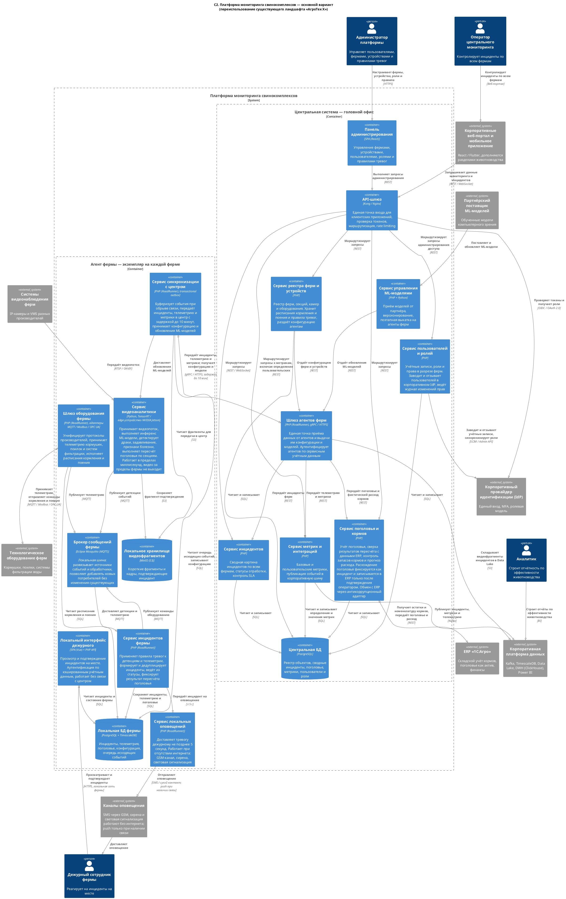
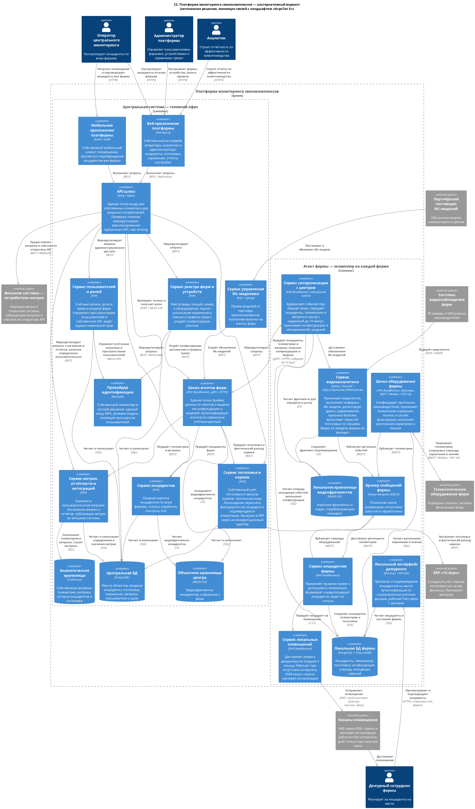

### **Название задачи:** Высокоуровневое видение решения: ограниченные контексты, контейнеры и интеграции

### **Автор:** Андрей Смолин

### **Дата:** 11.10.2026

> Развивает решение, принятое в [Task1](../Task1/ADR.md). Функциональные и нефункциональные требования приведены там и в данном документе не дублируются; ссылки вида «НФТ 2» указывают на таблицу нефункциональных требований Task1, «UC 3» — на таблицу Use Cases.

---

### **Функциональные требования**

Данное решение не вводит новых Use Cases. Декомпозиция до уровня контейнеров выполнена для сценариев UC 1 – UC 9 из [Task1](../Task1/ADR.md).

Соответствие сценариев ограниченным контекстам:

| **№** | **Use Case** | **Ограниченный контекст** |
| :-: | :- | :- |
| 1 | Фиксация нештатной ситуации средствами видеоаналитики | Видеоаналитика → Мониторинг и инциденты |
| 2 | Фиксация отклонения по телеметрии оборудования | Устройства и телеметрия → Мониторинг и инциденты |
| 3 | Пересчёт поголовья | Видеоаналитика → Кормление и поголовье |
| 4 | Управление кормлением и поением | Кормление и поголовье → Устройства и телеметрия |
| 5 | Контроль запасов кормов и прогноз расхода | Кормление и поголовье |
| 6 | Работа фермы при отсутствии связи с центром | Синхронизация |
| 7 | Подключение новой фермы и оборудования | Конфигурация и реестр объектов |
| 8 | Управление пользователями и ролями | Доступ |
| 9 | Передача метрик и добавление собственных метрик | Метрики и аналитика |

---

### **Нефункциональные требования**

Применяются нефункциональные требования 1 – 14 из [Task1](../Task1/ADR.md). Ниже зафиксировано, какими архитектурными средствами каждое из критичных требований закрывается на уровне контейнеров.

| **№** | **Требование** | **Как закрывается на уровне контейнеров** |
| :-: | :- | :- |
| 2 | Оповещение не позднее 5 секунд | Цепочка «камера → Сервис видеоаналитики → Брокер фермы → Сервис инцидентов → Сервис локальных оповещений → дежурный» целиком размещена на ферме и не содержит обращений к центру |
| 3 | Видеоаналитика в реальном времени | Инференс на edge-устройстве, видеопоток не покидает локальную сеть фермы |
| 4 | Работа без интернета | Локальная БД, локальное объектное хранилище, локальный интерфейс дежурного с офлайн-аутентификацией, локальные каналы оповещения |
| 5 | Синхронизация до 10 минут | Сервис синхронизации с паттерном transactional outbox, доставка пачками, гарантия at-least-once |
| 6 | Масштабируемость | Агенты независимы и не взаимодействуют между собой; центральные сервисы без состояния, состояние в БД |
| 7 | Расширяемость | Брокер фермы развязывает производителей и потребителей событий; шлюз оборудования расширяется адаптерами; пользовательские метрики описываются декларативно |
| 8 | Разнородное оборудование | Шлюз оборудования как антикоррупционный слой: адаптеры MQTT, Modbus, OPC UA |
| 9 | Аутентификация и авторизация | Проверка токенов на API-шлюзе, сервисные учётные данные для агентов на шлюзе агентов |
| 10 | Интеграционный контракт | API-шлюз как единая точка входа с версионированием контракта |

---

### **Решение**

#### Ограниченные контексты

Границы проведены по признаку единства языка предметной области и скорости изменений. Контексты, работающие в оперативном контуре фермы, отделены от контекстов центральной системы: у них разные требования к задержке, разный жизненный цикл и разные причины для изменений.

| **Контекст** | **Назначение** | **Ключевые понятия** | **Размещение** |
| :- | :- | :- | :- |
| **Видеоаналитика** | Инференс ML-модели по видеопотоку, выдача детекций и подсчёт поголовья | Видеопоток, детекция, уверенность модели, секция, кадр-подтверждение | Ферма (edge) |
| **Устройства и телеметрия** | Приём показаний и выдача команд оборудованию, нормализация протоколов | Устройство, показание, команда, адаптер, протокол | Ферма |
| **Мониторинг и инциденты** | Правила тревог, формирование и жизненный цикл инцидента, оповещение | Правило, инцидент, приоритет, статус, подтверждение, оповещение | Ферма + центр |
| **Кормление и поголовье** | Расписания кормления, учёт поголовья, запасы кормов и прогноз расхода | Расписание, норма, факт кормления, поголовье, остаток, прогноз | Центр |
| **Конфигурация и реестр объектов** | Реестр ферм, секций, устройств; хранение и раздача конфигурации агентам | Ферма, секция, устройство, агент, конфигурация, версия | Центр |
| **Синхронизация** | Обмен между фермой и центром, буферизация, разрешение конфликтов | Пакет синхронизации, очередь, курсор, конфликт | Ферма + центр |
| **Доступ** | Учётные записи, роли, области видимости, аудит прав | Пользователь, роль, область действия, право, запись аудита | Центр |
| **Метрики и аналитика** | Базовые и пользовательские метрики, витрины, публикация наружу | Определение метрики, значение, период, разрез, контракт публикации | Центр |
| **Управление ML-моделями** | Приём моделей от партнёра, версионирование, выкатка на агенты | Модель, версия, целевая группа ферм, статус выкатки | Центр |

#### Карта контекстов и способы интеграции

| **Отношение** | **Паттерн** | **Обоснование** |
| :- | :- | :- |
| Внешнее оборудование → Устройства и телеметрия | Anticorruption Layer | Модель данных производителя не должна протекать в домен. Адаптер переводит «регистр 40012» в понятие «расход воды» |
| Видеоаналитика → Мониторинг и инциденты | Published Language | Контракт события детекции фиксирован и не зависит от версии модели. Позволяет менять модель без изменения потребителей |
| Устройства и телеметрия → Мониторинг и инциденты | Published Language | Тот же контракт события для телеметрии, UC 2 обрабатывается тем же механизмом правил, что и UC 1 |
| Мониторинг и инциденты ↔ Синхронизация | Transactional Outbox | События и их отправка фиксируются в одной транзакции. Гарантирует, что при обрыве связи ничего не теряется (НФТ 4, 5) |
| Кормление и поголовье → ERP «1С:Агро» | Anticorruption Layer | ERP является системой-источником истины по складу. Платформа подстраивается под её контракт, изолируя его адаптером |
| Доступ → Провайдер идентификации | Conformist | Протокол OIDC и модель пользователя задаются IdP, платформа им следует |
| Метрики и аналитика → Внешние потребители | Open Host Service | Единый опубликованный контракт для всех потребителей вместо точечных интеграций (НФТ 10) |

#### Диаграммы контейнеров

Подготовлено два варианта, соответствующих решениям из [Task1](../Task1/ADR.md).

**Основной (интеграционный) вариант**

Исходник: [`C2_Container_Main.puml`](./C2_Container_Main.puml)

**Альтернативный (автономный) вариант**

Исходник: [`C2_Container_Alternative.puml`](./C2_Container_Alternative.puml)

**Контур фермы в обоих вариантах одинаков:** девять контейнеров, те же связи и технологии. Так получилось потому, что самые жёсткие требования (НФТ 2, 3, 4, 5) задаёт физика задачи: пропускная способность канала и время реакции. Варианты различаются только центральной системой.

| **Аспект центральной системы** | **Интеграционный** | **Автономный** |
| :- | :- | :- |
| Контейнеров в центре | 10 | 14 |
| Внешних систем | 8 | 6 |
| Клиентские приложения | Внешние корпоративные | Собственные веб и мобильный |
| Провайдер идентификации | Внешний корпоративный | Собственный Keycloak внутри границы |
| Аналитическое хранилище | Внешний корпоративный DWH | Собственный ClickHouse |
| Объектное хранилище центра | Внешний Data Lake | Собственный MinIO |
| Публикация метрик | В корпоративную шину Kafka | Через открытый API |

#### Обоснование выбора технологий интеграции

**1. Брокер на ферме: Eclipse Mosquitto (MQTT), а не Kafka**

Преимущества:
- MQTT является родным протоколом для IoT-оборудования: кормушки, поилки и датчики умеют публиковать в MQTT напрямую либо через простой адаптер;
- крайне низкие требования к ресурсам — брокер работает на сервере фермы рядом с остальными сервисами, не требуя отдельного узла;
- модель publish/subscribe развязывает производителей и потребителей событий, что прямо закрывает НФТ 7: новый обработчик подписывается на топик, существующие сервисы не меняются;
- поддержка QoS и Last Will обеспечивает обнаружение пропадания устройства, необходимое для UC 2.

Ограничения:
- отсутствует долговременное хранение сообщений и повторное чтение истории — для фермы это компенсируется локальной БД, которая и является хранилищем;
- при росте потока телеметрии выше порядка десятков тысяч сообщений в секунду на площадку Mosquitto перестанет справляться.

Порог смены решения: при переходе к потокам, требующим хранения и переигрывания событий на самой ферме, либо при превышении указанной нагрузки, на ферме следует рассматривать NATS JetStream или Redpanda как более лёгкую альтернативу Kafka. Для MVP с десятками устройств на площадку этот порог недостижим.

**2. Канал «ферма — центр»: gRPC поверх HTTPS, а не прямое подключение агентов к Kafka**

Преимущества:
- агент остаётся за NAT на нестабильном канале и инициирует соединение сам; брокерный клиент в таких условиях ведёт себя хуже;
- одна точка входа — шлюз агентов — позволяет аутентифицировать агента по сервисным учётным данным, ограничивать трафик и версионировать протокол;
- бинарная сериализация и сжатие экономят трафик, что существенно при GSM-канале (НФТ 12);
- при недоступности центра агент просто накапливает очередь, повторная доставка реализуется на уровне приложения вместе с дедупликацией по идентификатору события.

Ограничения:
- шлюз агентов становится точкой, требующей горизонтального масштабирования при росте числа ферм;
- реализация надёжной доставки ложится на прикладной код, тогда как брокер дал бы её из коробки.

Порог смены решения: при выходе за тысячи ферм либо при появлении требования переигрывать историю событий фермы следует переходить на брокерный транспорт с подключением агентов к выделенному кластеру.

**3. Шина центра: Apache Kafka (основной вариант)**

Преимущества:
- уже является корпоративным стандартом «АгроТех Х», эксплуатируется и мониторится существующей командой;
- хранение и переигрывание событий позволяют подключать новых потребителей без доработки платформы (НФТ 7);
- с запасом выдерживает поток со всех ферм: в центр приходят события и агрегаты, а не сырое видео;
- существующий маршрут Kafka → Data Lake → DWH переиспользуется без разработки.

Ограничения:
- требовательна к ресурсам и эксплуатации, на отдельной ферме неприменима;
- общий кластер означает разделение ресурсов с другими системами компании и необходимость согласования квот.

**4. Синхронные взаимодействия: REST, уведомления в интерфейсы: WebSocket**

REST выбран для запросов «запрос — ответ» между клиентами и центральными сервисами как наиболее простой и совместимый с существующими корпоративными клиентами вариант. WebSocket используется для доставки новых инцидентов в открытый интерфейс оператора без опроса. Ограничение: REST между центральными сервисами создаёт синхронную связанность; при росте числа сервисов часть взаимодействий следует переводить на событийную модель через ту же Kafka.

**5. Хранилища**

| Назначение | Технология | Обоснование |
| :- | :- | :- |
| Локальная БД фермы | PostgreSQL + TimescaleDB | Реляционная модель для инцидентов и конфигурации, расширение TimescaleDB для телеметрии. Один продукт вместо двух на ограниченных ресурсах фермы |
| Видеофрагменты | MinIO (S3) | Бинарные объекты не место в реляционной БД. S3-совместимость даёт единый код работы с хранилищем на ферме и в центре |
| Центральная БД | PostgreSQL | Транзакционные данные: реестр, инциденты, поголовье, права |
| Аналитическое хранилище (альтернативный вариант) | ClickHouse | Та же технология, что в корпоративном DWH, что снижает риск при возможной миграции между вариантами |

**6. Аутентификация: OIDC / OAuth 2.0, проверка токенов на API-шлюзе**

Токен проверяется на границе, прикладные сервисы получают уже установленный контекст пользователя. Агенты ферм используют отдельный механизм — сервисные учётные данные на шлюзе агентов, поскольку действуют от имени системы, а не человека. Локальный интерфейс дежурного работает на кэшированных учётных данных с ограниченным сроком действия. Это компромисс ради НФТ 4.

**7. Язык прикладных сервисов: PHP, ML-часть на Python**

Прикладные сервисы пишутся на PHP: это основной язык команды, и для сервисов с REST и работой с БД его достаточно. Долгоживущие процессы (подписчики MQTT, шлюзы, синхронизация) работают под RoadRunner: классический PHP-FPM рассчитан на короткие запросы и здесь не подходит. Инференс и работа с моделями остаются на Python, потому что модель партнёра поставляется под него, а под Jetson есть TensorRT.

Ограничение: клиенты MQTT, gRPC и Kafka для PHP менее зрелые, чем для Go или Java, поэтому их нужно выбрать и проверить на прототипе до начала разработки.

---

### **Альтернативы**

Ниже рассмотрены альтернативные решения, отклонённые на уровне контейнеров. Выбор между интеграционным и автономным вариантами в целом вынесен в [Task4](../Task4/ADR.md).

**Отправка видеопотока в центр и централизованный инференс.** Отклонено. Требует от 100 до 250 Мбит/с непрерывного трафика с одной площадки при нестабильном WiFi и делает невозможным выполнение НФТ 2 и 3. Централизация дала бы более простое управление моделями и меньшую стоимость edge-оборудования, но нарушает критичные требования.

**Умные камеры со встроенным инференсом вместо отдельного edge-устройства.** Отклонено для MVP. Снизило бы нагрузку на сервер фермы, но привязывает решение к модели конкретного производителя, тогда как по условию модель поставляется партнёром и должна работать на камерах разных вендоров (НФТ 8, 14).

**RabbitMQ на ферме вместо Mosquitto.** Рассматривалось. RabbitMQ поддерживает MQTT через плагин и даёт более богатую маршрутизацию, но требует заметно больше ресурсов при той же функциональности в рамках задач фермы. Для центра RabbitMQ не рассматривался, поскольку корпоративным стандартом является Kafka.

**Единый брокер Kafka для фермы и центра.** Отклонено. Устраняет различие технологий, но нарушает ограничение НФТ 11 по инфраструктуре фермы и не даёт выигрыша: на ферме не нужны ни переигрывание истории, ни партиционирование.

**Отказ от локального интерфейса дежурного в пользу мобильного приложения.** Отклонено. Мобильный клиент требует связи с центром, что нарушает НФТ 4. Локальная панель в сети фермы остаётся единственным интерфейсом, гарантированно доступным при обрыве канала.

**Прямое обращение центральных сервисов к базе данных друг друга.** Отклонено. Ускорило бы разработку MVP, но создаёт скрытую связанность и делает невозможным независимое развитие контекстов, нарушая НФТ 7.

---

**Недостатки, ограничения, риски**

| Риск | Последствие | Способ снижения |
| :- | :- | :- |
| Два разных брокера в решении (MQTT на ферме, Kafka в центре) | Рост сложности эксплуатации и порога входа для команды | Контракт событий единый, различается только транспорт. Шлюз агентов инкапсулирует переход между ними |
| Шлюз агентов — единая точка отказа для всего обмена с фермами | Остановка синхронизации по всем фермам | Горизонтальное масштабирование за балансировщиком; агенты накапливают очередь, данные не теряются |
| Локальная офлайн-аутентификация на ферме | Ослабленная модель безопасности на площадке | Короткий срок действия кэшированных учётных данных, ограниченный набор прав, физический контроль доступа к серверу фермы |
| Обновление ПО и ML-моделей на агентах всех ферм | Массовый сбой при неудачной версии | Поэтапная выкатка по группам ферм, автоматический откат по телеметрии состояния агента |
| Расхождение конфигурации между центром и агентом | Ферма работает по устаревшим правилам или расписаниям | Версионирование конфигурации, подтверждение применения агентом, отображение отставания в интерфейсе администратора |
| Transactional outbox даёт доставку at-least-once | Дубликаты инцидентов в центре | Идемпотентность по идентификатору события на стороне центра |
| Локальная БД фермы — единственная точка хранения до синхронизации | Потеря данных при отказе сервера фермы | Резервное копирование на ферме, приоритетная синхронизация инцидентов перед телеметрией |
| Выбор PHP для долгоживущих сервисов | Нестандартный сценарий для экосистемы, требует RoadRunner или аналога | Воркеры и подписчики брокера реализуются как долгоживущие процессы под управлением супервизора; классический FPM не применяется |
