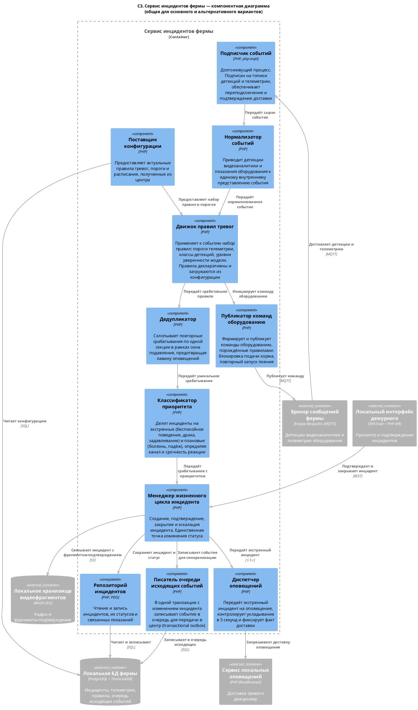
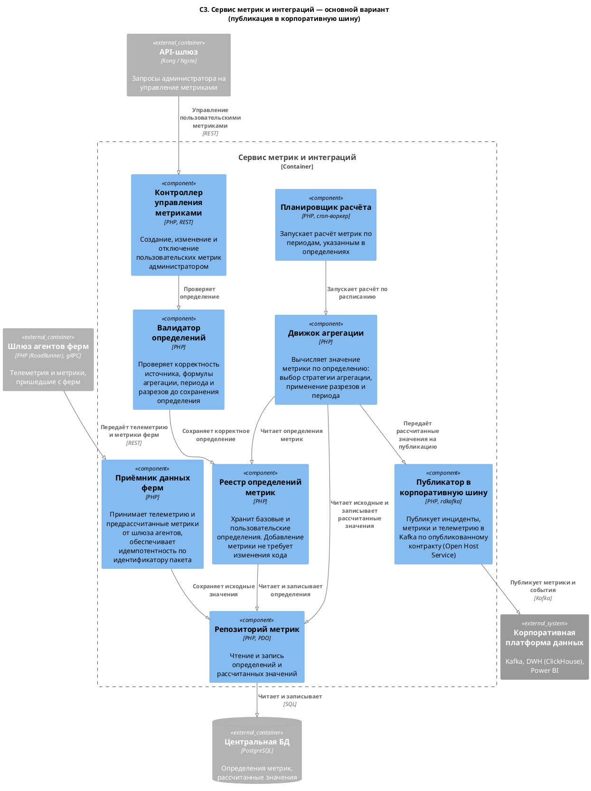
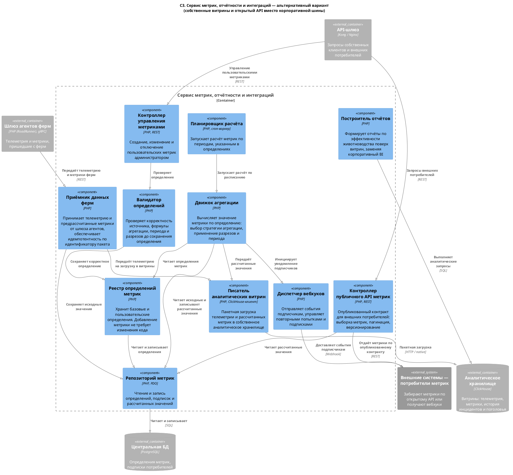
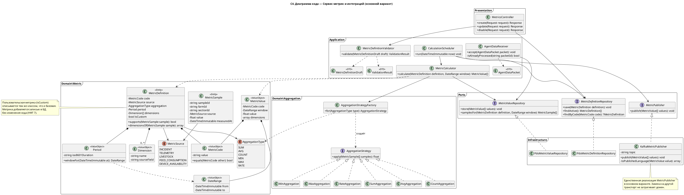
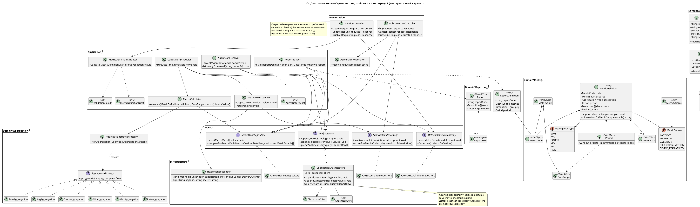

### **Название задачи:** Детализация решений до уровня компонентов и кода

### **Автор:** Андрей Смолин

### **Дата:** 11.10.2026

> Развивает решения из [Task1](../Task1/ADR.md) и [Task2](../Task2/ADR.md). Ссылки вида «НФТ 2» и «UC 3» указывают на таблицы требований в Task1.

---

### **Функциональные требования**

Новых Use Cases не вводится. Детализация выполнена для контейнеров, реализующих сценарии UC 1, UC 2 и UC 9.

#### Выбор контейнеров для детализации

Декомпозировать до уровня компонентов все контейнеры (19 в основном варианте, 23 в альтернативном) нецелесообразно: документ стал бы нечитаемым, а большая часть сервисов устроена типовым образом. Детализированы три контейнера, выбранные по двум критериям — критичность для требований и наличие различий между вариантами решения.

| **Контейнер** | **Почему выбран** | **Вариант** |
| :- | :- | :- |
| Сервис инцидентов фермы | Реализует самое жёсткое требование НФТ 2 (оповещение за 5 секунд) и оба сценария фиксации — UC 1 и UC 2. Ядро оперативного контура | Общий для обоих: контур фермы идентичен |
| Сервис метрик и интеграций | Реализует UC 9 и требование расширяемости НФТ 7. Точка, в которой варианты различаются максимально | Основной |
| Сервис метрик, отчётности и интеграций | Тот же сценарий в автономном варианте: собственные витрины, отчётность и открытый API вместо корпоративной шины и BI | Альтернативный |

---

### **Нефункциональные требования**

| **№** | **Требование** | **Как отражено на уровне компонентов и кода** |
| :-: | :- | :- |
| 2 | Оповещение за 5 секунд | Путь «Подписчик событий → Нормализатор → Движок правил → Дедупликатор → Классификатор приоритета → Менеджер инцидента → Диспетчер оповещений» не содержит обращений за пределы фермы. Запись в БД и в очередь исходящих событий выполняется после передачи инцидента на оповещение |
| 4 | Работа без интернета | Компонент «Писатель очереди исходящих событий» фиксирует событие в одной транзакции с изменением инцидента. Передача в центр не входит в путь обработки |
| 7 | Расширяемость | Правила тревог декларативны и загружаются «Поставщиком конфигурации». Метрика описывается классом `MetricDefinition` и хранится в БД: добавление пользовательской метрики не требует изменения кода |
| 8 | Разнородное оборудование | «Нормализатор событий» приводит детекции и телеметрию к единому представлению, изолируя различия источников |
| 10 | Интеграционный контракт | В основном варианте — `KafkaMetricPublisher` с опубликованным контрактом. В альтернативном — `PublicMetricsController` с версионированием через `ApiVersionNegotiator` |

---

### **Решение**

#### Компонентная диаграмма: Сервис инцидентов фермы (общая для обоих вариантов)

Исходник: [`C3_Component_IncidentService.puml`](./C3_Component_IncidentService.puml)

Ключевые решения внутри контейнера:

- **Конвейерная обработка.** Событие проходит фиксированную последовательность: приём, нормализация, применение правил, дедупликация, классификация приоритета, создание инцидента. Каждый шаг — отдельный компонент с единственной ответственностью, что позволяет менять правила или добавлять классы событий, не затрагивая остальные шаги.
- **Дедупликатор выделен отдельно.** При драке в секции модель выдаёт детекции непрерывно в течение десятков секунд. Без окна подавления дежурный получил бы лавину оповещений. От этого компонента напрямую зависит, можно ли вообще пользоваться системой, поэтому он вынесен отдельно от движка правил.
- **Классификатор приоритета реализует два потока UC 1.** Экстренные события (беспокойное поведение, драка, задавливание) идут в «Диспетчер оповещений» с контролем 5 секунд, плановые (болезнь, падёж) — только в рабочую сводку.
- **Менеджер жизненного цикла — единственная точка изменения статуса инцидента.** Подтверждение дежурным из локального интерфейса и автоматическое создание из правил проходят через него, что исключает расхождение состояний.
- **Transactional outbox.** «Писатель очереди исходящих событий» записывает событие синхронизации в той же транзакции, что и изменение инцидента. Это гарантирует, что при обрыве связи ни один инцидент не потеряется (НФТ 4, 5), ценой доставки at-least-once и необходимости идемпотентности на стороне центра.

#### Компонентная диаграмма: основной вариант

Исходник: [`C3_Component_Main.puml`](./C3_Component_Main.puml)

#### Компонентная диаграмма: альтернативный вариант

Исходник: [`C3_Component_Alternative.puml`](./C3_Component_Alternative.puml)

#### Что различается между вариантами на уровне компонентов

| **Компонент** | **Основной** | **Альтернативный** |
| :- | :-: | :-: |
| Контроллер управления метриками | есть | есть |
| Валидатор определений | есть | есть |
| Реестр определений метрик | есть | есть |
| Приёмник данных ферм | есть | есть |
| Планировщик расчёта | есть | есть |
| Движок агрегации | есть | есть |
| Публикатор в корпоративную шину | **есть** | нет |
| Писатель аналитических витрин | нет | **есть** |
| Построитель отчётов | нет | **есть** |
| Контроллер публичного API метрик | нет | **есть** |
| Диспетчер вебхуков | нет | **есть** |

Шесть компонентов из одиннадцати совпадают. Различия сосредоточены в способе доставки результата потребителю: публикация в корпоративную шину против собственного контракта и собственных витрин. Это подтверждает вывод Task2: варианты различаются не доменной логикой, а степенью опоры на корпоративную инфраструктуру.

#### Диаграммы кода

Исходник: [`C4_Code_Main.puml`](./C4_Code_Main.puml)

Исходник: [`C4_Code_Alternative.puml`](./C4_Code_Alternative.puml)

Решения уровня кода:

- **Гексагональная структура.** Домен (`Domain\Metric`, `Domain\Aggregation`) не зависит ни от БД, ни от транспорта. Все внешние взаимодействия объявлены интерфейсами в `Ports` и реализованы в `Infrastructure`. Переход от основного варианта к альтернативному сводится к замене реализаций портов, домен при этом не меняется.
- **Стратегия агрегации.** `AggregationStrategy` с реализацией под каждое значение `AggregationType` и фабрикой выбора. Новый тип агрегации добавляется новым классом без изменения существующих (НФТ 7).
- **Пользовательская метрика — не особый случай.** `MetricDefinition` с флагом `isCustom` описывает и базовые, и пользовательские метрики одинаково. Администратор добавляет метрику записью в таблицу, без релиза.
- **Обмен с ERP не входит в сервис метрик.** По карте контекстов ([Task2](../Task2/ADR.md)) антикоррупционный слой к «1С:Агро» принадлежит контексту «Кормление и поголовье», поэтому адаптер ERP находится в «Сервисе поголовья и кормов» и на этих диаграммах не показан. Различие вариантов сохраняется там: двусторонний обмен в основном варианте и односторонняя выгрузка в альтернативном.
- **Версионирование публичного API вынесено в отдельный класс.** `ApiVersionNegotiator` в альтернативном варианте — заготовка под публичный контракт SaaS-платформы из [Task5](../Task5/ADR.md).

---

### **Альтернативы**

**Детализация всех контейнеров.** Отклонено: объём документа вырос бы кратно без прироста информации, поскольку большинство сервисов устроены типовым образом «контроллер — сервис приложения — репозиторий».

**Детализация центрального сервиса инцидентов вместо фермерского.** Отклонено: центральный сервис является агрегатором и не содержит критичной по времени логики. Вся сложность, связанная с НФТ 2, сосредоточена на ферме.

**Реализация правил тревог кодом вместо декларативного описания.** Рассматривалось. Код даёт неограниченную выразительность, но каждое изменение порога требует релиза агента на все фермы. Выбрано декларативное описание с загрузкой из конфигурации; сложные правила, не укладывающиеся в декларативную модель, останутся исключением и будут реализованы кодом.

**Хранение рассчитанных метрик только в аналитическом хранилище (альтернативный вариант).** Отклонено: публичный API должен отдавать значения с низкой задержкой и по первичному ключу, что является сценарием транзакционной БД, а не колоночного хранилища. Принято дублирование: PostgreSQL для выдачи по API, ClickHouse для витрин и отчётов.

**Единый компонент вместо пары «Публичный API» и «Диспетчер вебхуков».** Отклонено: у них противоположные модели взаимодействия — pull и push — и разные требования к надёжности. Вебхуки требуют очереди повторных попыток, API не требует.

---

**Недостатки, ограничения, риски**

| Риск | Последствие | Способ снижения |
| :- | :- | :- |
| Конвейер в сервисе инцидентов выполняется последовательно | Деградация одного шага увеличивает общее время и ставит под угрозу НФТ 2 | Бюджет времени на каждый шаг, измерение сквозной задержки, тревога при приближении к 5 секундам |
| Окно подавления в дедупликаторе | Слишком большое окно скроет повторный инцидент, слишком малое вернёт лавину оповещений | Окно настраивается декларативно в правилах, подбирается по эксплуатации |
| Декларативные правила в руках администратора | Ошибочное правило способно отключить реагирование на целый класс событий | Валидация правил, версионирование, журнал изменений, запрет отключения обязательных правил |
| Доставка at-least-once из outbox | Дубликаты инцидентов и метрик в центре | Идемпотентность по идентификатору события в центральном сервисе инцидентов и по идентификатору пакета в `AgentDataReceiver` сервиса метрик |
| Дублирование метрик в PostgreSQL и ClickHouse (альтернативный вариант) | Расхождение значений между API и отчётами | Значения рассчитывает только `MetricCalculator`, в оба хранилища их записывает только `CalculationScheduler` |
| Гексагональная структура в PHP-проекте | Рост числа классов и порог входа для команды | Применяется только в сервисах с нетривиальным доменом; CRUD-сервисы остаются простыми |
