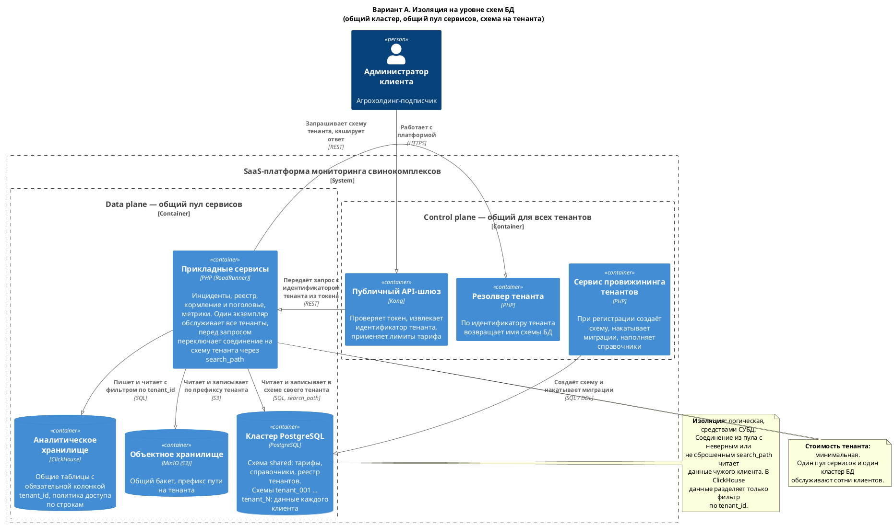
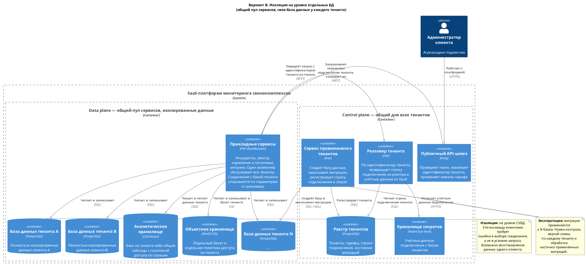
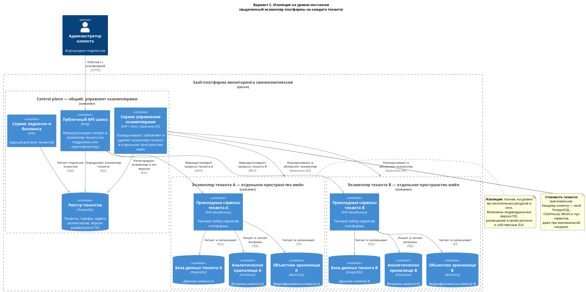
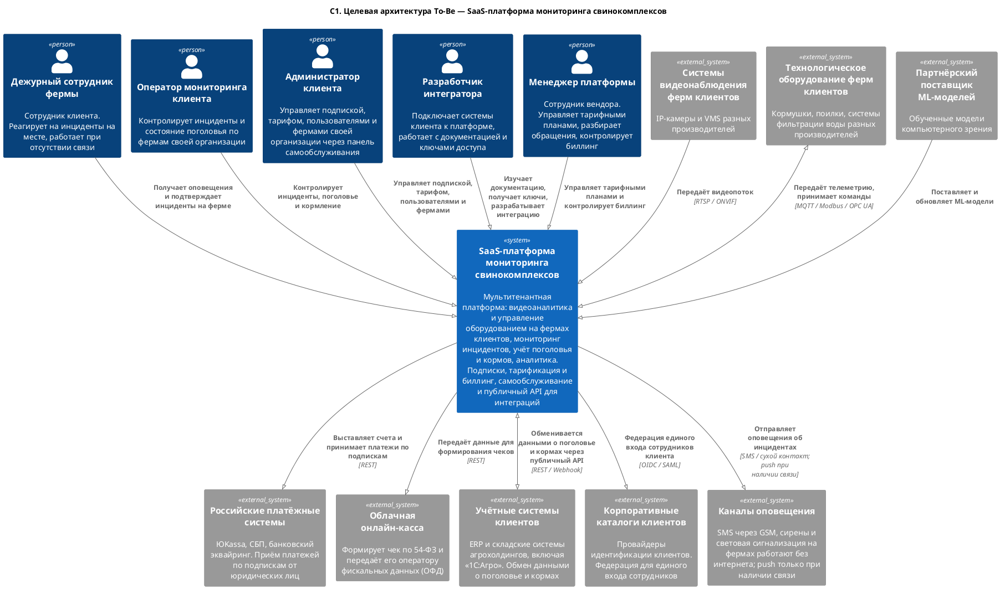
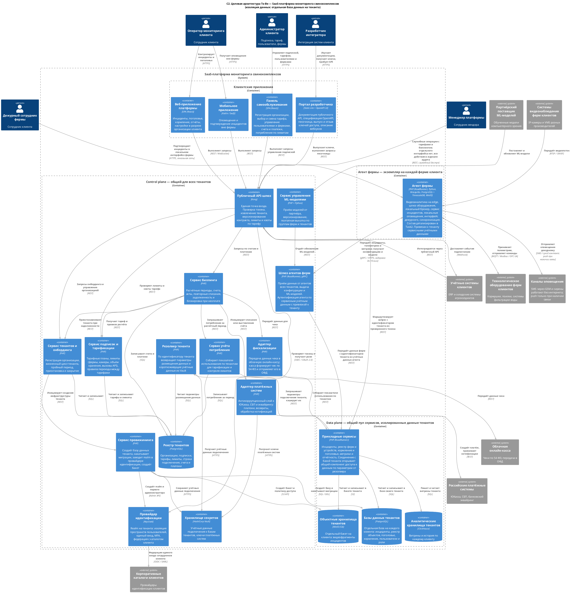
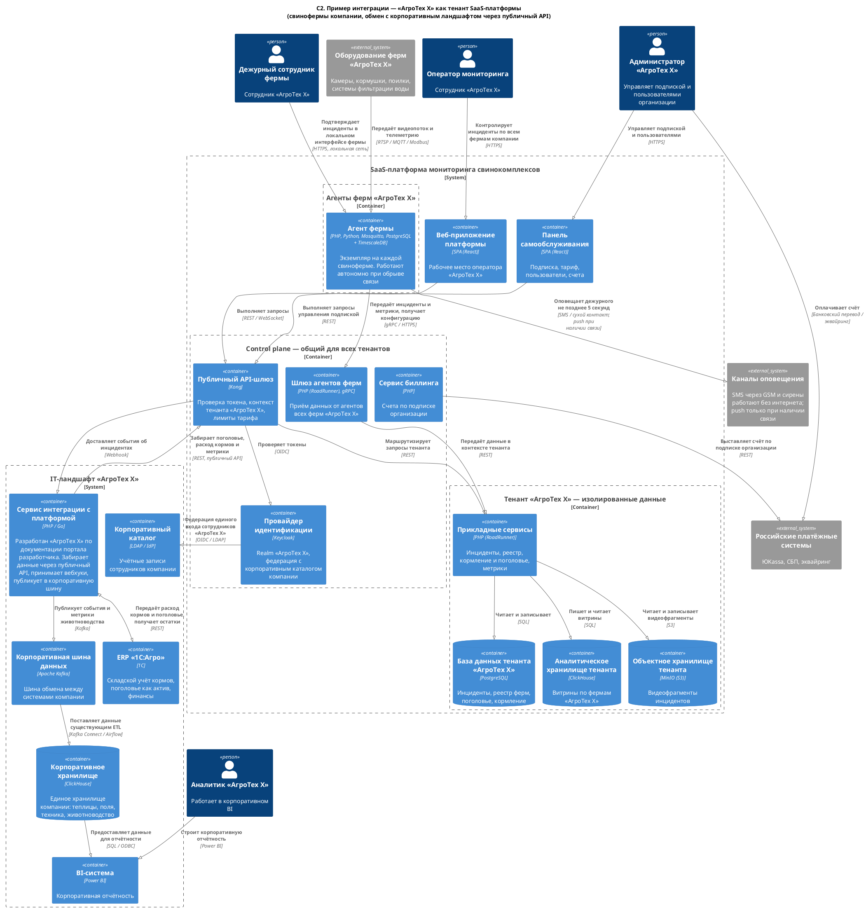

### **Название задачи:** Эволюция MVP в мультитенантную SaaS-платформу

### **Автор:** Андрей Смолин

### **Дата:** 11.10.2026

> Развивает **автономный вариант**, выбранный по критериям в [Task4](../Task4/ADR.md). Архитектура MVP описана в [Task1](../Task1/ADR.md), [Task2](../Task2/ADR.md) и [Task3](../Task3/ADR.md). Ссылки вида «НФТ 2» и «UC 3» указывают на таблицы требований Task1.

---

### **Функциональные требования**

Сценарии UC 1 – UC 9 сохраняются без изменений: они описывают работу платформы внутри одной организации и остаются применимыми для каждого тенанта. Ниже приведены Use Cases, появляющиеся при переходе к SaaS-модели.

| **№** | **Действующие лица или системы** | **Use Case** | **Описание** |
| :-: | :- | :- | :- |
| 10 | Администратор клиента, платформа, провайдер идентификации | Самостоятельная регистрация организации | 1. Представитель агрохолдинга регистрирует организацию в панели самообслуживания. 2. Платформа создаёт тенанта и выделяет ему изолированное хранилище данных. 3. В провайдере идентификации создаётся отдельное пространство пользователей организации и первый администратор. 4. Администратор получает доступ на пробный период с ограничениями тарифа «Пробный». 5. Администратор подключает первую ферму и приглашает сотрудников. |
| 11 | Администратор клиента, платформа, платёжные системы | Выбор и оплата тарифного плана | 1. Администратор выбирает тарифный план в панели самообслуживания. 2. Платформа проверяет, что текущее потребление организации укладывается в лимиты выбранного плана. 3. Платформа формирует счёт на расчётный период. 4. Оплата выполняется безналичным переводом по счёту либо картой через платёжный сервис. 5. После подтверждения платежа лимиты тарифа применяются, при необходимости формируется чек. 6. При неоплате по истечении льготного срока тенант переводится в режим ограниченного доступа. |
| 12 | Платформа, администратор клиента | Учёт потребления и контроль лимитов | 1. Платформа непрерывно учитывает потребление по тенанту: количество ферм и камер, объём хранения видеофрагментов, число вызовов API, число активных пользователей. 2. Потребление отображается администратору клиента в панели самообслуживания. 3. При приближении к лимиту тарифа администратор получает предупреждение. 4. При превышении применяется правило тарифа: мягкое ограничение либо тарификация сверх лимита. 5. По окончании расчётного периода потребление передаётся в биллинг. |
| 13 | Разработчик интегратора, платформа | Самостоятельная интеграция через публичный API | 1. Разработчик изучает документацию и спецификацию OpenAPI на портале разработчика. 2. Выпускает ключ доступа для своей организации с ограниченным набором прав. 3. Проверяет сценарии в песочнице на тестовых данных. 4. Подписывается на вебхуки по интересующим событиям. 5. Выводит интеграцию в эксплуатацию, контролируя лимиты по тарифу. |
| 14 | Администратор клиента, провайдер идентификации, корпоративный каталог клиента | Подключение единого входа организации | 1. Администратор клиента инициирует настройку федерации. 2. Указывает параметры подключения своего корпоративного каталога. 3. Платформа настраивает федерацию в пространстве пользователей организации. 4. Сотрудники клиента входят по корпоративным учётным данным. 5. При увольнении сотрудника доступ прекращается на стороне корпоративного каталога клиента. |

---

### **Нефункциональные требования**

| **№** | **Требование** |
| :-: | :- |
| 15 | **Изоляция данных.** Полная изоляция данных между клиентами. Данные одного тенанта недоступны другому ни при каких обстоятельствах, включая ошибку в прикладном коде. |
| 16 | **Горизонтальное масштабирование по числу клиентов.** Подключение нового клиента не требует изменения архитектуры и ручных операций. |
| 17 | **Самообслуживание.** Регистрация, выбор тарифа, управление пользователями и фермами выполняются клиентом самостоятельно, без участия сотрудников вендора. Отдельный интерфейс администратора вендора на текущем этапе не предусмотрен. |
| 18 | **Тарификация.** Гибкая система подписок с разными тарифными планами и измеримыми лимитами. |
| 19 | **Соответствие законодательству.** Расчёты с юридическими лицами по безналичному расчёту с закрывающими документами, фискализация по 54-ФЗ при оплате картой. |
| 20 | **Публичный интеграционный контракт.** Версионируемый API с документацией, достаточной для самостоятельной интеграции без участия вендора. |
| 21 | **Сбор метрик использования.** Учёт потребления по тенантам для тарификации и продуктовой аналитики. |
| 22 | **Восстановимость по тенанту.** Возможность восстановить или выгрузить данные отдельного клиента, не затрагивая остальных. |

---

### **Решение**

## Задача 1. Мультитенантная архитектура и изоляция данных

### Рассмотренные варианты изоляции

**Вариант A. Изоляция на уровне схем БД**

 · Исходник: [`C2_Isolation_SharedDb.puml`](./C2_Isolation_SharedDb.puml)

Общий кластер PostgreSQL, отдельная схема на каждого тенанта. Общий пул прикладных сервисов. Резолвер по идентификатору тенанта сообщает имя схемы, прикладной сервис переключает на неё соединение через `search_path`. Аналитические данные хранятся в общих таблицах ClickHouse с обязательной колонкой `tenant_id`.

**Вариант B. Изоляция на уровне отдельных баз данных**

 · Исходник: [`C2_Isolation_DbPerTenant.puml`](./C2_Isolation_DbPerTenant.puml)

Отдельная база данных на каждого тенанта, общий пул прикладных сервисов. Резолвер тенанта по идентификатору возвращает параметры подключения из реестра и короткоживущие учётные данные из Vault. Объектное хранилище — отдельный бакет с отдельной политикой доступа.

**Вариант C. Изоляция на уровне инстансов**

 · Исходник: [`C2_Isolation_InstancePerTenant.puml`](./C2_Isolation_InstancePerTenant.puml)

Отдельный экземпляр всей платформы на каждого тенанта в собственном пространстве имён Kubernetes. Общими остаются только маршрутизация, биллинг и оркестрация экземпляров.

### Критерии сравнения и анализ

| **№** | **Критерий** | **Вес** | **A: схемы** | **B: базы** | **C: инстансы** | **Обоснование** |
| :-: | :- | :-: | :-: | :-: | :-: | :- |
| 1 | Степень изоляции данных | 5 | 2 | 4 | 5 | В A граница между клиентами держится на `search_path` каждого соединения: соединение из пула с неверным или не сброшенным `search_path` либо запрос с явно указанной схемой читают чужие данные. В общих таблицах ClickHouse дополнительно нужен фильтр по `tenant_id`. В B для утечки нужна ошибка в выборе базы, что менее вероятно и проверяемо. В C изоляция обеспечена на уровне сети и вычислительных ресурсов |
| 2 | Стоимость обслуживания одного тенанта | 4 | 5 | 4 | 1 | В C каждому клиенту нужны собственные PostgreSQL, ClickHouse, MinIO и пул сервисов независимо от нагрузки. Малый клиент с тремя фермами становится убыточным |
| 3 | Масштабируемость по числу клиентов | 4 | 5 | 3 | 1 | A держит тысячи тенантов. B ограничен числом баз и соединений на кластер, требует шардирования после нескольких сотен. C практически не масштабируется по количеству |
| 4 | Простота эксплуатации и миграций | 3 | 5 | 3 | 2 | В A миграция применяется к схемам одного кластера. В B — к N базам с контролем версии схемы по каждой. В C — к N независимым развёртываниям |
| 5 | Скорость онбординга клиента | 4 | 5 | 4 | 2 | Создание схемы — секунды, создание базы с миграциями — минуты, развёртывание полного стека — десятки минут |
| 6 | Восстановление и перенос данных клиента | 4 | 2 | 5 | 5 | В A схему одного клиента можно выгрузить и загрузить (`pg_dump -n`), но восстановление на момент времени (PITR) работает только для кластера целиком: приходится поднимать копию кластера и переносить из неё схему. В B и C достаточно восстановить базу клиента |
| 7 | Изоляция нагрузки между клиентами | 3 | 1 | 3 | 5 | В A тяжёлый запрос одного клиента влияет на всех. В B влияние ограничено общим кластером и пулом сервисов. В C отсутствует |
| 8 | Индивидуальное размещение и SLA | 2 | 1 | 2 | 5 | Требования крупного клиента к региону размещения или собственной версии ПО выполнимы только в C |
| | **Взвешенная сумма (максимум 145)** | | **98** | **106** | **92** | |

Расчёт:
- A: 5·2 + 4·5 + 4·5 + 3·5 + 4·5 + 4·2 + 3·1 + 2·1 = 98
- B: 5·4 + 4·4 + 4·3 + 3·3 + 4·4 + 4·5 + 3·3 + 2·2 = 106
- C: 5·5 + 4·1 + 4·1 + 3·2 + 4·2 + 4·5 + 3·5 + 2·5 = 92

### Принятое решение

**Базовая модель — вариант B: отдельная база данных на тенанта.**

Обоснование:

1. **Требование 15 формулирует полную изоляцию данных.** В варианте A изоляция зависит от того, что каждое соединение из общего пула переключено на правильную схему, а каждый аналитический запрос отфильтрован по `tenant_id`. Одной ошибки в этом коде достаточно, чтобы данные одного агрохолдинга увидел другой. Для клиентов-конкурентов на одном рынке это неприемлемый риск, и тестированием его полностью не снять.
2. **Требование 22 о восстановимости по тенанту в варианте A выполняется только обходным путём:** восстановить копию всего кластера на нужный момент и перенести из неё схему клиента. Это долго и требует ручной работы прямо во время инцидента.
3. **Вариант C превосходит B по изоляции, но проигрывает по экономике.** При заявленной цели создать источник регулярного дохода и уменьшить совокупную стоимость владения для клиентов полностью выделенная инфраструктура на каждого подписчика противоречит бизнес-модели.

**Вариант C сохраняется как опция премиального тарифа.** Для крупного клиента с собственными требованиями к размещению, версии ПО или SLA разворачивается выделенный экземпляр. Архитектура это допускает: прикладные сервисы в обоих вариантах одинаковы, различается только способ выделения ресурсов и маршрутизация. Он оформляется как отдельный тарифный план.

**Вариант A отклонён полностью**, в том числе для пробного и базового тарифов: он не выполняет требования 15 и 22, а держать в эксплуатации три модели изоляции вместо двух нецелесообразно. Сочетание B и C допустимо, потому что прикладные сервисы и схема данных в них одинаковы, а различается только размещение. Цена этого решения указана в рисках.

### Механизм изоляции в принятом варианте

| Уровень | Как изолируется |
| :- | :- |
| Транзакционные данные | Отдельная база PostgreSQL. Строка подключения и учётные данные выдаются резолвером тенанта из реестра и Vault |
| Аналитические данные | Отдельная база ClickHouse на тенанта |
| Видеофрагменты | Отдельный бакет MinIO с собственной политикой доступа |
| Пользователи | Отдельное пространство пользователей (realm) в Keycloak на тенанта |
| Агенты ферм | Сервисные учётные данные агента привязаны к тенанту, шлюз агентов определяет тенанта до обращения к данным |
| Контекст запроса | Идентификатор тенанта извлекается из токена на API-шлюзе и далее не принимается из параметров запроса |

Архитектурное правило: **прикладной сервис не выбирает тенанта сам**. Идентификатор тенанта приходит только из проверенного токена (для агентов — из их сервисных учётных данных). По нему общий компонент доступа к данным, подключаемый в каждый сервис библиотекой, запрашивает у резолвера параметры подключения и открывает соединение с базой этого тенанта. Учётные данные выдаются на одну базу, поэтому даже при ошибке в прикладном коде соединение не даст доступа к чужим данным.

---

## Задача 2. Биллинг и монетизация

### Тарифные планы и единицы тарификации

Тарификация построена на подписке с лимитами по измеримым ресурсам. Единицы выбраны так, чтобы отражать создаваемую ценность и реальную стоимость обслуживания.

| **Единица тарификации** | **Почему выбрана** |
| :- | :- |
| Количество ферм (агентов) | Основная единица ценности для клиента и единица нагрузки на платформу |
| Количество подключённых камер | Определяет объём инференса и трафика видеофрагментов |
| Объём хранения видеофрагментов и глубина истории | Прямая себестоимость хранения |
| Количество активных пользователей | Отражает масштаб использования |
| Число вызовов публичного API и вебхуков | Ограничивает нагрузку от интеграций |

| **План** | **Назначение** | **Модель изоляции** |
| :- | :- | :- |
| Пробный | Ограниченный период, одна ферма, минимальная глубина истории | B |
| Базовый | Малые хозяйства: до нескольких ферм, базовые метрики, API только на чтение | B |
| Профессиональный | Средние агрохолдинги: без ограничения по фермам в пределах лимита, полный API, вебхуки, федерация единого входа | B |
| Корпоративный | Крупные клиенты: выделенный экземпляр, индивидуальные SLA и размещение, приоритетная поддержка | C |

### Сервисы монетизации

| Сервис | Ответственность |
| :- | :- |
| **Сервис подписок и тарификации** | Каталог тарифных планов, лимиты, правила перехода между планами, проверка допустимости смены тарифа при текущем потреблении |
| **Сервис учёта потребления** | Непрерывный сбор показателей использования по тенантам, агрегация за расчётный период, контроль приближения к лимитам (требование 21) |
| **Сервис биллинга** | Расчётные периоды, формирование счетов и закрывающих документов, повторные списания, учёт задолженности, перевод тенанта в ограниченный режим при неоплате |
| **Адаптер платёжных систем** | Антикоррупционный слой к платёжным провайдерам: создание платежа, обработка нотификаций, возвраты |
| **Адаптер фискализации** | Передача данных чека в облачную онлайн-кассу. Касса формирует чек по 54-ФЗ и сама отправляет его оператору фискальных данных |

Тарификация, учёт потребления и биллинг разделены, потому что меняются с разной скоростью. Тарифные планы меняет бизнес часто, правила учёта потребления — редко, логика расчётов и документооборота меняется при изменении законодательства.

### Интеграция с российскими платёжными системами

**Основной способ расчётов — безналичный перевод по счёту.** Клиенты платформы это юридические лица, агрохолдинги. Для них платёж картой нетипичен: нужен счёт, акт и закрывающие документы для бухгалтерии. Поэтому базовый сценарий — формирование счёта платформой, оплата клиентом через свой банк, сверка поступления по выписке или через банковский API.

**Дополнительные способы:**

| Способ | Применение | Особенности |
| :- | :- | :- |
| **ЮKassa** | Оплата картой для малых клиентов и пробного периода, рекуррентные списания по сохранённому способу оплаты | Требует фискализации по 54-ФЗ |
| **СБП для бизнеса** | Оплата по QR-коду или платёжной ссылке, зачисление в реальном времени | Ниже комиссия по сравнению с эквайрингом |
| **Банковский эквайринг** | Резервный канал оплаты картой | Используется при недоступности основного провайдера |

**Архитектурные решения:**

- Адаптер платёжных систем изолирует различия провайдеров: домен оперирует понятиями «счёт», «платёж», «возврат» и не знает форматов конкретного сервиса. Смена провайдера — это новая реализация порта.
- Нотификации от платёжных систем обрабатываются идемпотентно: повторная доставка одной и той же нотификации не должна приводить к повторному зачислению.
- Ключи платёжных систем хранятся в Vault и не попадают в конфигурацию приложения.
- Фискализация выделена в отдельный адаптер, поскольку требуется только при оплате физическим лицом или картой и регулируется отдельным законодательством.
- Состояние подписки меняет только сервис биллинга. Прикладные сервисы читают текущие лимиты через сервис подписок и не знают о платежах.

---

## Задача 3. Интеграции с клиентами

### Объём функциональности публичного API

| **Область** | **Доступно** | **Права** |
| :- | :- | :- |
| Инциденты | Список, карточка, статус, ссылка на видеофрагмент с ограниченным сроком действия | Чтение, подтверждение и закрытие |
| Поголовье | Текущее значение по фермам и секциям, история пересчётов | Чтение |
| Кормление | Расписания, факты кормления, фактический расход | Чтение и изменение расписаний |
| Запасы кормов | Остатки, прогноз расхода, предупреждения о пороге | Чтение, загрузка остатков из учётной системы клиента |
| Фермы и устройства | Реестр ферм, секций, камер и оборудования | Чтение, регистрация устройств |
| Метрики | Базовые и пользовательские метрики, значения за период | Чтение, определение пользовательских метрик |
| Подписка | Текущий тариф, потребление, счета | Чтение |

**Сознательно не предоставляется:**

| **Что** | **Почему** |
| :- | :- |
| Сырой видеопоток | Не покидает ферму по архитектуре. Доступны только фрагменты-подтверждения по ссылке с ограниченным сроком действия |
| Прямое управление оборудованием в обход правил | Безопасность животных и оборудования. Управление доступно только через расписания и регламентированные команды |
| Низкоуровневая конфигурация агентов и выкатка ML-моделей | Зона ответственности вендора. Ошибка клиента вывела бы ферму из строя |
| Данные других тенантов и внутренние метрики платформы | Требование 15 |

### Модель доступа

- **Аутентификация:** OAuth 2.0 client credentials для межсистемного взаимодействия. Ключ выпускается в разрезе организации и имеет ограниченный набор прав.
- **Авторизация:** права выдаются по областям доступа, раздельно на чтение и изменение. Минимально необходимый набор по умолчанию.
- **Лимиты:** ограничение частоты запросов и суточных квот по тарифному плану, применяется на API-шлюзе.
- **Версионирование:** версия в пути запроса. Обратно несовместимые изменения выпускаются новой версией, предыдущая поддерживается заранее объявленный срок.
- **Вебхуки:** подписка на события — создание и закрытие инцидента, результат пересчёта поголовья, достижение порога запаса корма, потеря связи с устройством. Доставка с повторными попытками по возрастающему интервалу, подпись тела запроса секретом подписки.

### Портал разработчика

| Раздел | Назначение |
| :- | :- |
| Документация | Сценарии интеграции, модель данных, схема аутентификации, описание ошибок |
| Спецификация OpenAPI | Машиночитаемый контракт, пригодный для генерации клиента |
| Песочница | Тестовый тенант с предзаполненными данными, запросы выполняются из браузера |
| Ключи доступа | Выпуск, ограничение прав и отзыв ключей организации |
| Вебхуки | Управление подписками, журнал доставки, повторная отправка |
| История изменений | Объявления о новых версиях и сроках вывода старых из эксплуатации |

Портал разработчика является частью требования об онбординге: клиент должен иметь возможность интегрироваться без обращения к вендору (требование 20).

---

## Задача 4. Целевая архитектура To-Be

### Контекстная диаграмма

Исходник: [`C1_Context_SaaS_ToBe.puml`](./C1_Context_SaaS_ToBe.puml)

Изменения относительно MVP ([Task1](../Task1/ADR.md)):

- акторы разделились на пользователей клиента и сотрудников вендора;
- появились внешние системы монетизации: платёжные системы и облачная онлайн-касса для фискализации;
- «ERP 1С:Агро» обобщилась до «учётных систем клиентов», поскольку у каждого агрохолдинга она своя;
- появились корпоративные каталоги клиентов для федерации единого входа;
- добавился актор «разработчик интегратора» — потребитель публичного API.

### Контейнерная диаграмма

Исходник: [`C2_Container_SaaS_ToBe.puml`](./C2_Container_SaaS_ToBe.puml)

Архитектура разделена на четыре контура:

| Контур | Назначение | Отношение к тенантам |
| :- | :- | :- |
| **Клиентские приложения** | Веб, мобильное приложение, панель самообслуживания, портал разработчика | Общие, работают в контексте тенанта |
| **Control plane** | Онбординг, провижининг, идентификация, подписки, потребление, биллинг, платежи, шлюз агентов, управление моделями | Общий для всех тенантов |
| **Data plane** | Прикладные сервисы и изолированные данные | Сервисы общие, данные изолированы по тенантам |
| **Агент фермы** | Контур фермы из [Task2](../Task2/ADR.md) без изменений | Привязан к тенанту сервисными учётными данными |

**Что не изменилось при переходе к SaaS.** Агент фермы, прикладные сервисы и доменная модель остались прежними, ради этого в [Task4](../Task4/ADR.md) и был выбран автономный вариант. Добавились control plane и изоляция данных. Прикладной код почти не знает о мультитенантности: соединение с базой тенанта открывает общий компонент доступа к данным по параметрам от резолвера.

### Пример интеграции: «АгроТех Х» как клиент платформы

Исходник: [`C2_Integration_AgroTechAsClient.puml`](./C2_Integration_AgroTechAsClient.puml)

Компания, для которой разрабатывался MVP, становится одним из тенантов. Что это означает практически:

1. **Все свинофермы компании** подключены как агенты тенанта «АгроТех Х» и работают без изменений.
2. **Изолированные данные:** собственная база PostgreSQL, собственное аналитическое хранилище, собственный бакет видеофрагментов.
3. **Единый вход:** в Keycloak создано пространство пользователей «АгроТех Х» с федерацией к корпоративному каталогу. Сотрудники входят по корпоративным учётным данным, отзыв прав при увольнении происходит на стороне компании. Это закрывает риск, зафиксированный в [Task4](../Task4/ADR.md) для автономного варианта.
4. **Интеграция с ландшафтом ведётся силами самой компании.** «АгроТех Х» разрабатывает интеграционный сервис по документации портала разработчика: забирает данные публичным API, принимает вебхуки об инцидентах, публикует в корпоративную Kafka. Дальше данные идут существующим маршрутом в DWH и Power BI, аналитик работает в привычном BI.
5. **Обмен с «1С:Агро»** выполняется тем же интеграционным сервисом: остатки кормов загружаются в платформу, фактический расход и подтверждённое поголовье возвращаются в ERP.
6. **Тариф и оплата.** Профессиональный тариф (модель изоляции B), оплата по счёту. Выделенный экземпляр компании не нужен: особых требований к размещению или версии ПО у неё нет. Если они появятся, тенант переносится на корпоративный тариф (вариант C).

Интеграция с корпоративным ландшафтом переехала **на сторону клиента**: вендор публикует контракт и не поддерживает отдельные интеграции под каждый агрохолдинг. Без этого стоимость сопровождения росла бы с каждым новым клиентом, и SaaS-модель не масштабировалась бы.

---

### **Альтернативы**

**Изоляция на уровне строк в общих таблицах (`tenant_id` + row-level security).** Рассматривалась как разновидность варианта A. Отклонена: даёт лучшую плотность размещения, но изоляция полностью зависит от корректности политик безопасности и прикладного кода, что не удовлетворяет требованию 15.

**Выделенный экземпляр для всех клиентов (только вариант C).** Отклонено: противоречит бизнес-цели по снижению совокупной стоимости владения и делает малых клиентов убыточными.

**Собственный процессинг платежей вместо адаптера к провайдерам.** Отклонено: требует лицензирования, сертификации и несопоставимо с профилем компании.

**Биллинг по фактическому потреблению без подписки.** Рассматривалось. Даёт более справедливую цену, но делает расходы клиента непредсказуемыми, что плохо сочетается с годовым бюджетированием в агросекторе. Выбрана подписка с лимитами и тарификацией сверх лимита.

**Общий провайдер идентификации без разделения пространств пользователей.** Отклонено: одинаковые адреса электронной почты у разных клиентов и федерация с разными корпоративными каталогами требуют изолированных пространств.

**Предоставление клиентам прямого доступа к их базе данных для аналитики.** Отклонено: фиксирует схему БД как публичный контракт и делает невозможной её эволюцию. Для аналитики предоставляются API метрик и выгрузка.

**Сохранение интеграций с системами каждого клиента на стороне вендора.** Отклонено: стоимость поддержки растёт линейно с числом клиентов, что не позволяет масштабировать SaaS-модель.

---

**Недостатки, ограничения, риски**

| Риск | Последствие | Способ снижения |
| :- | :- | :- |
| Миграции схемы применяются к N базам | Частично применённая миграция оставляет тенантов в разных версиях схемы | Версия схемы в реестре тенантов, поэтапное применение с контролем, совместимость кода с двумя соседними версиями схемы |
| Ограничение числа баз и соединений на кластер | Упор в потолок при росте числа клиентов | Шардирование по кластерам, пулер соединений, перенос тенанта между кластерами как штатная операция |
| Резолвер тенанта — единая точка отказа и доступа | Отказ останавливает платформу; компрометация даёт доступ ко всем базам | Горизонтальное масштабирование, кэширование параметров подключения в сервисах, учётные данные в Vault с коротким сроком действия, аудит обращений |
| Идентификатор тенанта из недоверенного источника | Доступ к чужим данным при ошибке в коде | Идентификатор извлекается только из подписанного токена на API-шлюзе и никогда не принимается из параметров запроса. Проверка в интеграционных тестах |
| «Шумный сосед» в общем пуле сервисов | Нагрузка одного клиента влияет на остальных | Квоты и ограничение частоты запросов по тарифу, вынос крупных клиентов на выделенные экземпляры (вариант C) |
| Два контура изоляции (B и C) | Удвоение сценариев эксплуатации и тестирования | Прикладные сервисы идентичны, различается только способ выделения ресурсов. Общий конвейер развёртывания |
| Зависимость от платёжного провайдера | Невозможность принимать платежи при его недоступности | Адаптер поддерживает несколько провайдеров, основной канал — безналичный расчёт по счёту, не зависящий от провайдера |
| Изменение законодательства о расчётах и фискализации | Доработка биллинга в сжатые сроки | Фискализация вынесена в отдельный адаптер, домен биллинга от неё не зависит |
| Публичный API становится обязательством | Невозможно изменить контракт без согласования с клиентами | Версионирование, объявленный срок поддержки версии, история изменений на портале разработчика |
| Отсутствие интерфейса администратора вендора | Операции поддержки выполняются вручную | Признано ограничением текущего этапа согласно условию. Необходим минимальный набор служебных операций с обязательным аудитом |
| Данные клиентов-конкурентов на одной платформе | Репутационный риск при любом инциденте с изоляцией | Изоляция на уровне СУБД, аудит доступа, регулярная проверка политик, возможность перехода на выделенный экземпляр |
| Агент фермы находится в периметре клиента | Вендор не контролирует физический доступ к серверу фермы | Шифрование локальных данных, ограниченный срок действия сервисных учётных данных, возможность отзыва агента |
